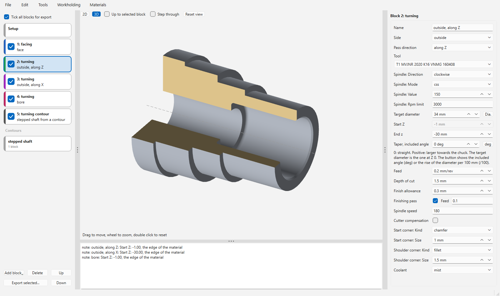
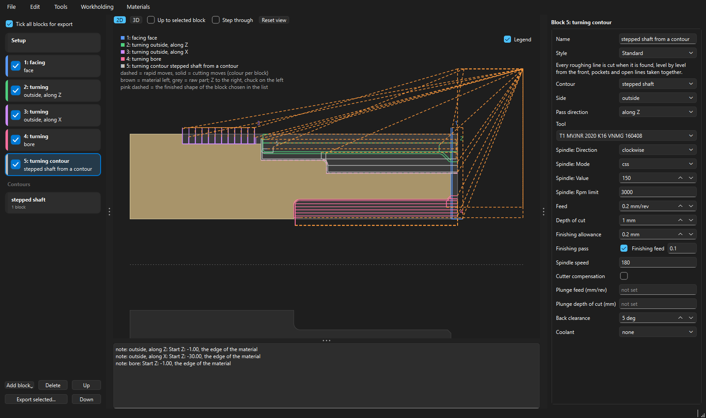

# WOP - Workshop Optimised Programming (LinuxCNC lathe)

Workshop-style programming for LinuxCNC lathes (XZ): you describe the raw part, then add blocks (facing, turning, turning along a contour, grooving, drilling, threading, a path you draw, machine functions), and WOP plans the tool paths, checks them for collisions, estimates the power, shows the result in 2D and 3D and writes the G-code through a postprocessor. A partly tested LinuxCNC post comes with it; other controllers are supported through post description files, which you can write and edit yourself with the post editor. It is a quick workshop tool, not a CAM package: it plans what you draw, and tells you where the tool cannot reach or collides.

Version 0.1.0, the first release. WOP is a standalone app (Windows and Linux); it has no connection to LinuxCNC yet, you copy the G-code file to the machine. A small bridge to LinuxCNC is planned for after the first release.

&nbsp;&nbsp;&nbsp;&nbsp;&nbsp;&nbsp;&nbsp;&nbsp;&nbsp;&nbsp;&nbsp;&nbsp;&nbsp;&nbsp;&nbsp;

## Before you run a program on a lathe
- **Every postprocessor, the shipped one too, can crash a machine.** WOP writes the G-code from text files; check what it writes before you run it, and run a new program in the air first (no material, tool well away from the chuck). The check in WOP (the red crosses and the messages) helps, but it does not replace your eyes.
- **What was run on a real machine:** only the shipped LinuxCNC post, on one lathe (a Schaublin 125 CNC with LinuxCNC 2.9.8), by me. Toolpaths, threading, canned cycles and the general behaviour worked there, but there may still be bugs.
- **The other posts are untested:** the Fanuc-style and the plain G-code post in `examples/posts` are reference files to import and edit, written from my rough understanding of these controllers.
- **Workholding:** for now use only the clamping plane (the stick-out in the Setup). The chuck and jaws drawings work, but they are not recommended yet.
- **The examples use my machine's tool change position and limits.** Set up your own machine (File > Machines) before you export G-code from one of them.

## Install
**Windows: a portable, precompiled version in a zip.** Unpack `WOP-0.1.0-windows.zip` anywhere and start `WOP.exe`. Nothing is installed. Settings, machines and libraries are kept in the folder `user_data` next to `WOP.exe`, so you can copy the whole folder to another PC. If you delete the folder `user_data`, WOP uses `%APPDATA%\WOP` instead. The program is not signed: Windows SmartScreen or a virus scanner may warn about it the first time.

**Linux** (tested on Debian 13 only; other Debian versions and distributions with Python 3.11 or newer and the venv module should work but are not tested):
- Once, as root: `apt install python3-venv gcc python3-dev libxcb-cursor0 libxkbcommon-x11-0 libxcb-icccm4 libxcb-image0 libxcb-keysyms1 libxcb-render-util0 libxcb-shape0 libxcb-xinerama0 libegl1 libgl1 libfontconfig1 libdbus-1-3`. `gcc` and `python3-dev` are for compiling the core; the libraries after them are for the window: without them WOP starts with no window and the terminal says "Could not load the Qt platform plugin xcb".
- Then, as your normal user (not with `sudo` or `su`): `bash tools/install_linux_compiled.sh`. It makes a virtual environment, installs WOP, compiles the core (about twice as fast planning), and writes the start command `wop`, an entry in the application menu and an icon on the desktop. `--uninstall` removes it. It worked on a lathe PC with an Intel N100; when the compiling fails, WOP is still installed and works as plain Python, and the script says why.
- Files copied from Windows lose the executable mark: run the script with `bash`, or `chmod +x tools/install_linux_compiled.sh` first.

**From the source (any system with Python 3.11 or newer):** `pip install ezdxf PySide6 numpy`, then `python tools/wop_app.py`. The 3D view needs OpenGL 2 (any PC from about 2009 on, or the software renderer of Mesa on Linux); without OpenGL the 2D picture is used. Optional, about twice as fast planning: `pip install mypy setuptools`, then `python tools/build_compiled.py` compiles the core. It needs a C compiler: the C++ build tools of Visual Studio on Windows, `gcc` and the Python headers on Linux (`sudo apt install gcc python3-dev`). `--clean` goes back to plain Python.

**Hardware:** WOP is made for screens of 1024 x 768 and larger. I don't know the lowest hardware that still runs fine. If you try it directly on an old machine, please let me know how it went.

## First start
1. Open `examples/pawn.wop.json` (File > Open): a chess pawn in brass with real values. Click through the flow list on the left, see the picture in the middle (2D and 3D, step through the moves), and the form of the block on the right.
2. Make your own machine (File > Machines) and choose it in the Setup (the first entry of the flow list). Set the raw part, add blocks with Add block, choose the tools in the Tools view.
3. File > Export G-code writes the file; WOP asks first when its check found problems.

The `examples` folder: `pawn.wop.json`, `reference.wop.json` (a first program with a bore), `left_hand_rest_machining.wop.json` (rest machining with a left-hand tool, finishing with two contours), `blocks/` (one small project per block type), `posts/` (reference posts to import: Fanuc style, plain G-code, LinuxCNC with a custom machine function) and `example.machine.json` (a machine to edit).

The user manual is in the zip (WOP_manual.pdf, next to WOP.exe). It is a first version: please tell me what is wrong or missing. Its source is in `docs/manual` in the repository (LaTeX; `python tools/make_manual.py` builds the PDF, it needs MiKTeX).

## Give the repository to an AI assistant
WOP was written together with an AI model and is made to be worked on that way. If you give this repository to an AI coding assistant, tell it to read `CLAUDE.md` first: the rules of the project, how to run the tests and the layers of the code. `tools/sandbox_standin/` is a stand-in for a build sandbox where PySide6 cannot be installed.

## For developers
- `docs/wop_01_design_notes.md`: design, package layout, decisions and guesses (read this first); `docs/wop_02_requirements.md`: requirements and progress; `docs/wop_03_conventions.md`: the coding and doc rules
- `docs/wop_04_code_tour.md`: a tour of the code: the folders, and what calls what from a block to the G-code and in the window
- All tools and their arguments: `tools/TOOLS.md`. Command line without a window: `python tools/wop_run.py examples/reference.wop.json [--block N] [--machine examples/example.machine.json] [--accept-all]` writes G-code (`.ngc`) and a picture (`.svg`) into `wop_output/`
- Tests, from this folder: `python tools/run_tests.py` (several processes) or `python -m unittest discover -s tests -t .`; coding conventions: `python tools/check_conventions.py`
- Posts are text files `wop/post/posts/*.post.ini` (your own go in the `posts` folder of the user folder); `python tools/list_post_tokens.py` lists what a post may use.
- The areas need no library (`wop/core/geometry/`).

## Licence
WOP is under the MIT licence (`LICENSE`). The programs it uses (ezdxf, numpy, Qt and PySide6 under the LGPL-3.0, and others) and where their source is are listed in `THIRD_PARTY_NOTICES.md`; it is copied into the folder of `WOP.exe` by `tools/build_exe.py`.

## Credits
WOP is written by LooksAboutRight together with Claude (an AI model by Anthropic), working in Claude Code.

## Inspiration
WOP was inspired by Andy Pugh's [Lathe Macros](https://github.com/andypugh/LatheMacros) for LinuxCNC (discussion: [LinuxCNC forum](https://forum.linuxcnc.org/41-guis/26550-lathe-macros)): conversational canned cycles for the common lathe operations, inside the machine screen.
